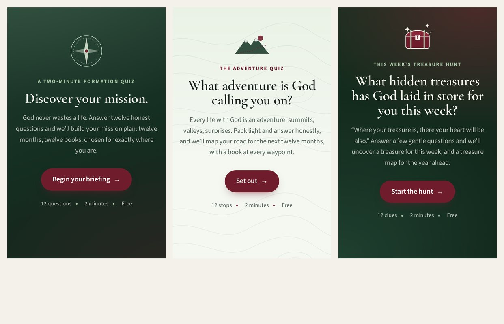
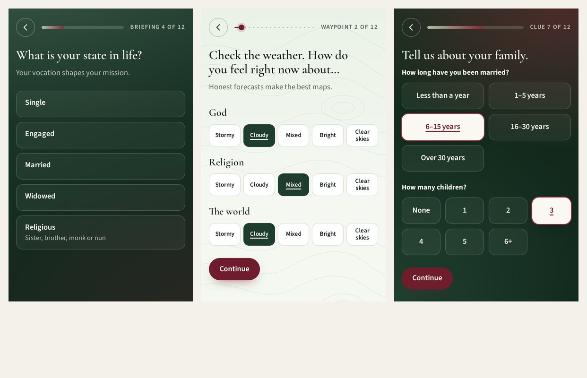
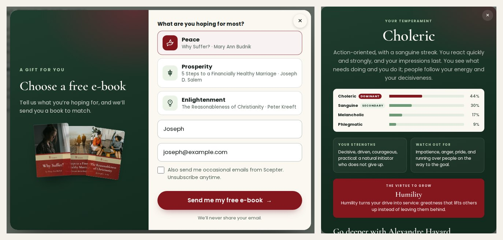

# Scepter quiz kit

Three formation quizzes, a free e-book pop-up and a temperament test for
[scepterpublishers.org](https://scepterpublishers.org), built as Shopify theme sections.
Everything is editable from the Shopify admin, and a recommendation engine turns each reader's
answers into a twelve-month reading plan, one book a month.

- **Discover your mission!** Dark green, a mission briefing.
- **What adventure is God calling you on?** Light green, a trail map.
- **What hidden treasures has God laid in store for you this week?** Deep green and burgundy, a
  treasure map that digs deeper into the backlist.



All three ask the same things, each in its own order and voice:
- **age** and **religion**;
- **gender**: male or female, with **Other** offered unless the reader answered Catholic, Muslim or Latter-day Saint;
- **work**;
- **state in life**, with follow-ups: married asks *how long* and *how many children*; religious asks *which order*; priest asks *secular or religious* and *parochial or not*;
- **how they feel about God, religion and the world** (three dials);
- **their faith**;
- **home life** from 1 to 10;
- **how they feel about work**, and **how much it serves God and others**;
- whether they want to **grow, learn or discover**;
- then **email**, for the plan.



The reader sees their plan at once and gets it by email. Each book says why it was chosen, in
their own terms. The first comes with a practice for the week. Any book can be swapped ("Read it
already?"), added to the cart, or all of the first three at once. If God, religion or the world
feel pretty poor, the plan starts with Fr. Jacques Philippe.


The **free e-book pop-up** asks for a name, an email, and one of three interests (peace,
prosperity, enlightenment), each with its own e-book. The **temperament test** gives the reader
their dominant and secondary temperament and the virtue to grow, then offers Scepter's Alexandre
Havard books with add-to-cart buttons.



How books are chosen, with a worked example: **[ALGORITHM.md](ALGORITHM.md)**.

> **The temperament test is Alexandre Havard's own**, read from virtuousleadership.com: his 48
> statements, his two stages, his twelve profiles, scored exactly as his page scores them. His
> words are the copyright of Virtuous Leadership (HVLI), and this repository is public, so they
> live in one file kept in the **private Heron repository**, `scepter-havard/scepter-temperament-havard.js`.
> Upload that file to the theme and the pop-up runs his test. **Ask HVLI's permission before it
> goes live.** Scepter publishes his books, so it should be a short email. Until the file is in
> place, the pop-up runs the kit's own stand-in questions. See [The temperament test](#the-temperament-test).

## Try it without Shopify

```sh
cd EdwardTQuest && npx serve .      # then open http://localhost:3000/scepter/demo/
```

The demo runs the real code on a small mock catalogue: real Scepter titles and handles, sample
prices and ranks. A "lead inspector" in the corner shows exactly what Klaviyo, a webhook and
Shopify would receive.

## Install on Shopify (about 30 minutes, once)

A developer or anyone comfortable with *Online Store → Themes → Edit code* can do this.

1. **Duplicate your live theme** (Online Store → Themes → ⋯ → Duplicate) and work on the copy.
2. **Upload the files** in `theme/` into the same folders of the theme:
   - `assets/`: the six `scepter-*.js`, `scepter.css`, and the three `.woff2` fonts. For Havard's
     test, use the real `scepter-temperament-havard.js` from Heron in place of the placeholder;
   - `sections/`: four `.liquid` files;
   - `snippets/`: four `.liquid` files;
   - `templates/`: four `page.scepter-*.json` files.

   With the Shopify CLI: `shopify theme push --path scepter/theme --theme <copy id> --nodelete`.
3. **Create the pages** (Online Store → Pages → Add page), each with its template:

   | page title | template | suggested URL |
   |---|---|---|
   | Discover your mission | `scepter-mission` | /pages/discover-your-mission |
   | What adventure is God calling you on? | `scepter-adventure` | /pages/adventure |
   | This week's hidden treasures | `scepter-treasures` | /pages/hidden-treasures |
   | Your reading plan | `scepter-reading-plan` | /pages/reading-plan |

   The quiz templates already point at the Best Sellers and six-month best-sellers collections.
   They carry five starter rules, using real Scepter products (Jacques Philippe, Havard, *Why
   Priests?*, *Sanctifying Ordinary Work*, *The Faith Explained*).
4. **Create the book library** (see [Filling in the books](#filling-in-the-books)). Run
   `setup/create-formation-book.mjs`, or create it by hand from `setup/README.md`.
5. **Add the pop-ups.** Customize → Footer → Add section → *Scepter e-book pop-up*, and again for
   *Scepter temperament test*. Pick the e-books and the Havard books in their settings.
6. **Connect email** (see [Email](#email)). Paste the Klaviyo public key and list ID into each
   section, and build the three flows from `setup/klaviyo/`.
7. **Check it** on the theme preview, take a quiz yourself, then publish the theme.

## Filling in the books

The engine reads the **whole catalogue** by itself, so a plan works from day one. To steer it,
use the **Formation book** library: *Content → Metaobjects → Formation book → Add entry*. Pick a
product, then tick:

| field | what it does |
|---|---|
| Themes | what the book is about (peace, prayer, work, marriage, leadership …) |
| Good for | who it is for. Without **Everyone**, only those readers get it. With **Everyone**, those readers get it more often |
| Depth | Gentle, Steady or Deep: gentle books come early in a plan |
| Seasons | Advent, Lent, Easter, Our Lady's months … A book tied to Advent or Lent is kept for its season |
| Start with this book when… | pulls it into the first three months for those readers |
| Why this book | a line shown to readers under the book |
| Editorial boost | −3 (rarely) to +3 (often) |
| Never recommend | keeps it out of every plan |

For many at once, fill in a spreadsheet like `setup/formation-books.csv`. It has twenty-seven
titles to start, with suggested tags: review them before use. Then run
`setup/import-formation-books.mjs`.

**Starter rules** live on each quiz page (Customize → the quiz → *Starter rule* blocks): "when the
reader *feels pretty poor about God, religion or the world*, give one of *these books* in
*month 1*". There are thirty-six conditions to choose from: married, parents, priests, leaders,
work that doesn't feel like service, wants to learn … A rule can also name an author ("Jacques
Philippe") instead of books.

Other knobs in each quiz section:
- the **share of bestsellers** (70% by default; the treasure quiz uses 55%);
- the **most books by one author**;
- **books to nudge** in that quiz;
- **topic collections**, which teach the engine whole shelves at once (e.g. `fr-jacques-philippe: peace, prayer`);
- **tags or handles to never recommend** (tag a product `no-quiz`).

## Changing the quizzes

Each quiz section's **Variant** picks the voice. The heading, introduction and start button can
be overridden in the section. The questions' wording lives in `assets/scepter-quiz.js` under
`COPY`, one block per variant. Colours (dark green, light green, burgundy, cream) and fonts are
section settings.

## The pop-ups

- **Free e-book.** Three *E-book* blocks, one per interest: label, e-book title, cover, and the
  download link (upload the PDF or EPUB in Content → Files). It opens after a delay, a scroll
  depth, or exit intent (all adjustable). It never shows on a page with a quiz, never twice in a
  session, and stays away 14 days after a dismissal. Any link to `#free-ebook` opens it; so does
  `?sp=ebook` in a URL (useful in ads and emails). The reader can download at once, and gets the
  book by email too when Klaviyo or a webhook is connected. Without one, the thank-you says only
  "ready to download".
- **Temperament test.** A floating button ("What's your temperament?"), plus any link to
  `#temperament-test`. Pick a book for everyone (*From Temperament to Character*), one per
  temperament (the dominant one decides), and a collection for the rest (*alexandre-havard*). The
  result shows the reader's own book first, marked *Written for you*.

In the theme editor, clicking either section opens its pop-up so you can see your edits.

## The temperament test

**Alexandre Havard's test, as his page runs it.** Each screen is one statement, answered TRUE or
FALSE, "with the first reaction that appears before thinking".
1. **Stage 1:** sixteen statements, four per temperament, in four rounds. TRUE gives that
   temperament a point. FALSE gives half a point to its opposite (choleric and phlegmatic, sanguine
   and melancholic).
2. **Ties:** if two or more share first place, each asks two more statements. A tie that remains
   goes to more TRUE answers.
3. **Stage 2:** after "Your dominant temperament is …", six statements weigh the two neighbouring
   temperaments.
4. **Result:** one of twelve profiles (*The Doer*, *The Contemplative Doer*, … *The Demonstrative
   Mediator*). It is *pure* when stage 1 was clear and stage 2 was balanced. Otherwise the secondary
   temperament is *light* or *marked*.

A reader answers 22 statements, or 26–30 after a tie. The result gives:
- the profile, and the virtue-challenge (humility, boldness, persistence or magnanimity);
- the four virtue-challenges, the reader's own marked;
- strength, weakness and challenge, in his words, and his line on temperament and character;
- then the Havard books.

`theme/assets/scepter-temperament.js` (`twoStage`) holds the method. Its tests check every rule on
made-up statements. `npm run crosscheck:havard` runs it against Havard's own scoring functions,
taken from his site, on 100,000 random answer sheets: zero differences. A deliberate one-character
change to the purity rule makes it fail.

**Installing it.** The theme ships a placeholder `assets/scepter-temperament-havard.js`. Replace
it with the real file:
- from the private **Heron** repository (branch `claude/scepter-interactive-quizzes-dqo2rl`,
  `scepter-havard/scepter-temperament-havard.js`); or
- by running `npm run import:havard` in `scepter/`. This reads the test from virtuousleadership.com
  and writes `scepter/private/scepter-temperament-havard.js` (git-ignored). Add `--lang es`, `fr`
  or `ru` for his other languages. If his site changes how it scores, the importer refuses and
  says what changed.

Never commit the real file to this public repository. Once HVLI agrees, you can put *"used with
permission"* in the section's **Credit line**. Left blank, the credit reads "Alexandre Havard's
Temperament Test, from Virtuous Leadership (virtuousleadership.com)" and links to his test.

**The stand-in.** Without the file, or with **Question set** switched to *Stand-in questions*,
the pop-up asks twenty-two forced-choice questions of the kit's own. They use the same four
temperaments and the same virtue for each. Each is a block in the section (up to 46). Each of its
four answers counts for one temperament or none, and a question can weigh double. *Stand-in result
words* blocks rewrite the result per temperament. To build a new set from a spreadsheet
(`prompt, answer_1, score_1 … answer_4, score_4, weight`), run
`node scepter/tools/build-temperament-section.mjs questions.csv`. It writes a new preset: remove
and re-add the section to use it. Never present the stand-in as Havard's test.

## Email

Each section sends a new lead to any of:

- **Klaviyo** (recommended). With the public API key and a list ID, the reader is subscribed (if
  they ticked the box) and an event is recorded: *Completed Formation Quiz*, *Requested Free
  E-book* or *Completed Temperament Test*. The quiz event carries the whole plan. Build one flow
  per event from the templates in `setup/klaviyo/`: they print the twelve months, the e-book link,
  the temperament.
- **A webhook** (Zapier, Make, your own), as a form-encoded POST including the full JSON.
- **Shopify customers**, via the newsletter form, tagged (`scepter-quiz`, `quiz-mission`,
  `persona-peacemaker`, `interest-peace`, `temperament-choleric` …) for segments in Shopify Email.

**Privacy and consent.**
- Religion and gender shape the plan, but they are *not* sent to the email platform unless you tick
  "Send religion and gender" in the quiz section. Neither are the answers that imply them: priest,
  religious, clergy and the order.
- The marketing checkbox is separate from receiving the plan, the e-book or the result. It starts
  unticked, because a pre-ticked box is not valid consent under GDPR or Canada's anti-spam law.
  Only a ticked box subscribes the reader to your list or Shopify's newsletter.
- Under-18s are asked to confirm a parent's permission.
- Plan links carry only book handles, never names or emails.
- The plan email itself contains the plan and its title, since that is what the reader asked for.

## For developers

```sh
cd scepter
npm install              # liquidjs and theme-check, for the tests and lint
npm test                 # 38 tests: engine, quiz logic, and the Liquid → JSON → engine contract
npm run check:theme      # Shopify theme-check on theme/ (0 offenses)
npm run screenshots      # walks every quiz and pop-up at phone and desktop sizes (Playwright)
```

| path | what |
|---|---|
| `theme/assets/scepter-engine.js` | the recommendation engine (pure; runs in the browser and in Node) |
| `theme/assets/scepter-quiz.js` | the quiz: questions, the three voices, branching, results, the plan page |
| `theme/assets/scepter-popups.js` | the pop-up manager, the e-book offer and the temperament test |
| `theme/assets/scepter-temperament.js` | Havard's two-stage method (`twoStage`), the stand-in scoring and questions |
| `theme/assets/scepter-temperament-havard.js` | placeholder for Havard's statements and profiles (the real file is in Heron) |
| `theme/assets/scepter-lead.js` | Klaviyo / webhook / Shopify lead capture |
| `theme/assets/scepter.css` | all styling, as tokens; three variant treatments |
| `theme/sections/*.liquid` | the four sections and their editor settings |
| `theme/snippets/*.liquid` | product JSON, colours, fonts, lead settings |
| `theme/templates/page.scepter-*.json` | the four page templates, pre-filled |
| `setup/` | metaobject definition, CSV import, Klaviyo email templates |
| `demo/` | local preview with a mock catalogue |
| `tests/` | `node --test` suites |
| `tools/` | screenshots, theme-check, Havard test importer, stand-in preset builder |
| `private/` | git-ignored: where `npm run import:havard` writes Havard's test |

The scripts work on any modern browser and need no build step. They talk to Shopify only through
its public storefront endpoints: `/products.json`, `/products/<handle>.js`, `/cart/add.js` and
`/contact`.

**What was verified, and how:**
- 38 automated tests pass (`npm test`).
- An independent review found 12 defects, all fixed and re-checked in Chromium:
  - the temperament pop-up failed to load when the e-book pop-up sat above it;
  - the result email subscribed people without asking;
  - double taps skipped questions;
  - swapped-out books came back;
  - the Treasures answer colours and focus rings had weak contrast;
  - other smaller ones.
- theme-check reports 0 offenses.
- The Liquid is rendered with liquidjs and mock store objects, and its output is fed through the
  engine.
- Every quiz and both pop-ups were walked end to end in Chromium at 390 px and 1280 px, with zero
  script errors, and every screen was looked at.
- **Not verified:** a live Shopify store (the build environment could not reach
  scepterpublishers.org). So the real product data, the real collection handles and Shopify's
  storefront responses are untested here. Test on a duplicated theme before publishing.
